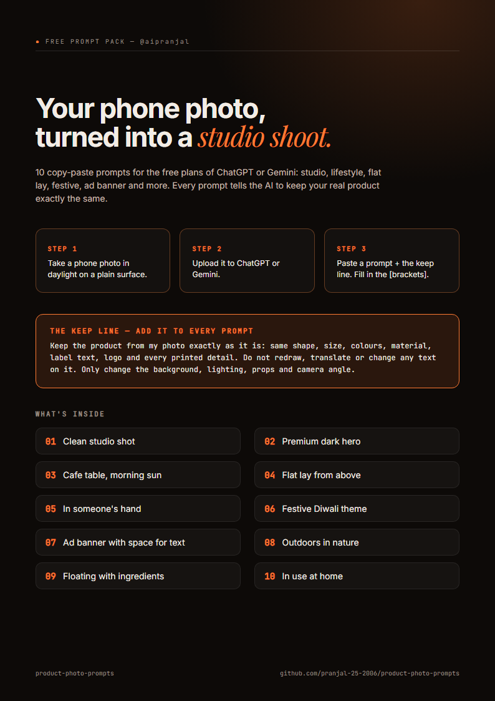

# 10 product photo prompts (phone photo -> studio shot)

Free prompts that turn a phone photo of your product into a studio, lifestyle or festive shot in the free plans of ChatGPT or Gemini. Shared by [@aipranjal](https://www.instagram.com/aipranjal/).



**PDF version:** [product-photo-prompts.pdf](product-photo-prompts.pdf)

## How to use

1. Open ChatGPT or Gemini (free plans work, with daily limits).
2. Upload a phone photo of your product.
3. Paste one prompt below, then paste the **keep line** under it.

**Keep line (add it to every prompt):**

```
Keep the product from my photo exactly as it is: same shape, size, colours, material, label text, logo and every printed detail. Do not redraw, translate or change any text on it. Only change the background, lighting, props and camera angle.
```

## 1. Clean studio shot
*Best for: Website, Amazon / Flipkart, catalogue*

```
Turn my photo into a professional e-commerce studio shot. Put the product in the centre on a seamless [pure white / light grey / soft pastel] background, with soft diffused studio light from the left, a gentle natural shadow under it and sharp focus. Square 1:1, high resolution, like a full-frame camera with a 100mm lens.

Keep the product from my photo exactly as it is: same shape, size, colours, material, label text, logo and every printed detail. Do not redraw, translate or change any text on it. Only change the background, lighting, props and camera angle.
```

## 2. Premium dark hero
*Best for: Launch posts, premium products*

```
Make a premium hero shot of my product on a glossy black surface with a soft reflection, a dark gradient background, a thin rim light outlining its edges and one warm key light from above. Moody, luxury, high contrast, 4:5 portrait.

Keep the product from my photo exactly as it is: same shape, size, colours, material, label text, logo and every printed detail. Do not redraw, translate or change any text on it. Only change the background, lighting, props and camera angle.
```

## 3. Cafe table, morning sun
*Best for: Instagram feed, lifestyle*

```
Place my product on a wooden cafe table by a window in warm morning sunlight, with a coffee cup and a folded newspaper softly out of focus behind it, natural shadows and a shallow depth of field. Real photo look, 4:5 portrait.

Keep the product from my photo exactly as it is: same shape, size, colours, material, label text, logo and every printed detail. Do not redraw, translate or change any text on it. Only change the background, lighting, props and camera angle.
```

## 4. Flat lay from above
*Best for: Carousels, product + what goes with it*

```
Create a top-down flat lay of my product on a [linen / marble / kraft paper] surface, surrounded by a few props that suit a [your category, e.g. skincare / tea / stationery] brand, neatly arranged with breathing space. Even soft daylight, no harsh shadows, 1:1 square.

Keep the product from my photo exactly as it is: same shape, size, colours, material, label text, logo and every printed detail. Do not redraw, translate or change any text on it. Only change the background, lighting, props and camera angle.
```

## 5. In someone's hand
*Best for: Shows real size, feels personal*

```
Show my product held naturally in a person's hand, close-up, with a softly blurred [home / street / office] background. Natural skin, relaxed fingers, the product facing the camera with its front label fully visible. 4:5 portrait.

Keep the product from my photo exactly as it is: same shape, size, colours, material, label text, logo and every printed detail. Do not redraw, translate or change any text on it. Only change the background, lighting, props and camera angle.
```

## 6. Festive Diwali theme
*Best for: Festival offers and greetings*

```
Put my product in a festive Diwali scene: glowing clay diyas, marigold flowers, a little rangoli and warm golden bokeh lights in the background, on a rich [maroon / deep green] cloth. Warm, joyful, premium, 4:5 portrait. (Swap Diwali for Holi, Eid, Christmas or Raksha Bandhan.)

Keep the product from my photo exactly as it is: same shape, size, colours, material, label text, logo and every printed detail. Do not redraw, translate or change any text on it. Only change the background, lighting, props and camera angle.
```

## 7. Ad banner with space for text
*Best for: Ads, offers, website banners*

```
Make a clean advertising image with my product on the right third of the frame and plenty of empty, uncluttered space on the left for a headline. Simple [brand colour] gradient background, soft studio light, a subtle shadow. Do not add any text, letters or logos to the image. 16:9 landscape.

Keep the product from my photo exactly as it is: same shape, size, colours, material, label text, logo and every printed detail. Do not redraw, translate or change any text on it. Only change the background, lighting, props and camera angle.
```

## 8. Outdoors in nature
*Best for: Natural, organic and outdoor brands*

```
Place my product on a smooth stone outdoors with green leaves and soft dappled sunlight around it and a hint of water droplets, background softly blurred. Fresh, natural, bright, 4:5 portrait.

Keep the product from my photo exactly as it is: same shape, size, colours, material, label text, logo and every printed detail. Do not redraw, translate or change any text on it. Only change the background, lighting, props and camera angle.
```

## 9. Floating with ingredients
*Best for: Food, drinks, cosmetics*

```
Make a dynamic shot of my product floating slightly in the air against a [colour] background, with its key ingredients [e.g. coffee beans / orange slices / rose petals] floating around it, frozen mid-air, crisp studio light. Energetic, high-end commercial look, 4:5 portrait.

Keep the product from my photo exactly as it is: same shape, size, colours, material, label text, logo and every printed detail. Do not redraw, translate or change any text on it. Only change the background, lighting, props and camera angle.
```

## 10. In use at home
*Best for: Shows where it belongs*

```
Show my product in a real, tidy [living room / kitchen / bathroom shelf / desk] where it would normally be used, as the clear focus of the photo, with soft window light and a few everyday items around it. Looks like a real home photo, not a 3D render. 4:5 portrait.

Keep the product from my photo exactly as it is: same shape, size, colours, material, label text, logo and every printed detail. Do not redraw, translate or change any text on it. Only change the background, lighting, props and camera angle.
```

## Tips

- Shoot the phone photo in daylight on a plain surface, product filling most of the frame, label facing you.
- Upload the photo first, then paste the prompt. Fill in the [brackets] for your product.
- If the label or logo changes, reply: "The label changed. Keep the product exactly as in my original photo and regenerate only the background."
- Want a small change? Reply "Keep everything, only change [the background colour / the light / the props]".
- Always check the label, colours and size against the real product before you post. Sell what you actually ship.
- Amazon's main product image needs a pure white background: use prompt 1 with pure white.
- Free plans have daily image limits, so if you hit one, try the other app or come back tomorrow.

## License

MIT, see [LICENSE](LICENSE). Use them, change them, share them.
